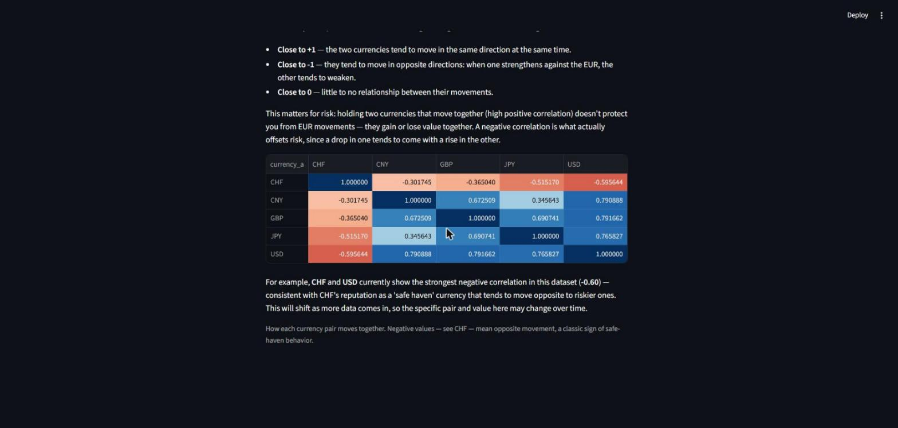

# FX-Pipeline

A daily currency exchange rate pipeline: fetches, stores, and serves EUR exchange rates (EUR → USD, GBP, JPY, CHF, CNY) on an automated schedule — built to be safely re-runnable, not just to work once.

**Live dashboard:** https://fx-pipeline.streamlit.app/



## Status

- [x] Extract, Transform, Load — done, deployed to AWS RDS
- [x] Orchestrate — scheduled with GitHub Actions
- [x] Serve — Streamlit dashboard with 4 business-question views (price change, volatility, trend, correlation), deployed to Streamlit Community Cloud
- [ ] Automated tests (pytest) — not yet, see "What's next"

Data: ~5,000 rows (5 currency pairs, daily, backfilled from 2024-01-01). Live row count and latest date: see the dashboard.

## Stack

Python, pandas, psycopg2, PostgreSQL (AWS RDS), GitHub Actions, Streamlit, Docker.

## Run locally

```
git clone https://github.com/Hazzardbx/FX-Pipeline.git
cd FX-Pipeline
pip install -r requirements.txt
python main.py                # full-history backfill from 2024-01-01
cd serve
streamlit run app.py          # opens the dashboard at localhost:8501
```

Needs a PostgreSQL database (your own instance or a local install) and a `.env` with `POSTGRES_HOST`, `POSTGRES_DATABASE`, `POSTGRES_USER`, `POSTGRES_PASSWORD`.

The scheduled job does not run `main.py`: it runs `scripts/daily_ingest.py`, which loads only the days after the last date already in the table.

## Architecture

**Extract → Transform → Load → Orchestrate → Serve**

- **Extract** — pulls rates from the Frankfurter API (free, no key). The backfill script retries with exponential backoff on server errors; the daily job uses a request timeout and fails the run on any HTTP error.
- **Transform** — drops incomplete rows and converts rates to numeric types before anything touches the database.
- **Load** — upserts into Postgres using a composite primary key (`date, base, quote`) with `ON CONFLICT ... DO UPDATE`, so re-runs are safe by design. The daily job also checkpoints on `MAX(date)`, so it resumes from the day after the last loaded one. Idempotent by design; an automated test for this is planned.
- **Orchestrate** — a scheduled GitHub Actions workflow (`.github/workflows`) runs the daily job once per weekday. Rates update once a day, so anything more frequent would be pointless polling. If there is no new day to load, the run exits successfully; if the API errors or returns no rates, the run fails visibly (red) instead of reporting success.
- **Serve** — a Streamlit app that's strictly read-only. It never calls the API and never writes to the database — that job belongs entirely to the scheduled workflow.

## Why I built it this way

I came into the bootcamp from SAP ABAP development, where ticket work meant code that had to keep running after I shipped it. I didn't want a project that only proves I can clean a CSV. I wanted one that shows the same mindset: a pipeline designed to be re-run safely, not a script that works once.

That's why idempotency is the actual point of this project, not a checkbox. Published daily rates don't change, so the backfill (from 2024-01-01) only needs to happen once — the daily job just adds the missing days, and the upsert means a failed run, a double trigger, or catching up after downtime does not duplicate a row.

The read-only Serve layer came out of a conversation with my instructor about what happens if multiple people hit the app at once and it fetched data on demand: race conditions, duplicate API calls, possible write conflicts. Splitting "who writes" (the scheduled workflow) from "who reads" (the app) makes concurrent users a non-issue instead of something I'd have to engineer around with locks or queues.

## What's next

- Automated tests (pytest) for the Transform step: normal values, nulls, wrong types, duplicates
- A test that runs the Load twice and proves the row count doesn't change
- Run the tests in CI on every push
- Retry with backoff in the daily job (currently only the backfill script has it)
- Data-quality check: older history contains weekend rows, probably from mixing data sources between the backfill and the daily job — I'm investigating, then reloading from a single source and adding a test for it
- Cross-currency pairs (e.g. USD→CNY) via a SQL self-join — currently only EUR-based pairs are stored, everything else can be derived at query time
- A time-series model on the historical backfill: train on 2025, predict 2026, backtest against the real 2026 rates I already have
- A second API source as a fallback if Frankfurter goes down
- Splitting `main.py` into proper modules (`extract/`, `transform/`, `load/`, `orchestrate/`, `serve/` already exist as empty folders) — deliberately postponed until the core logic was working end-to-end, so I wasn't debugging both logic and file structure at once

## Note on branches

`master` is the clean version. `with-comments` is preserved as a snapshot of the working state before cleanup — decision log, dead ends, and all — if you want to see how the thing actually got built rather than the tidy final cut.
